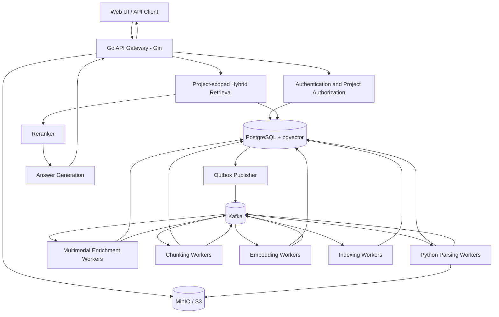
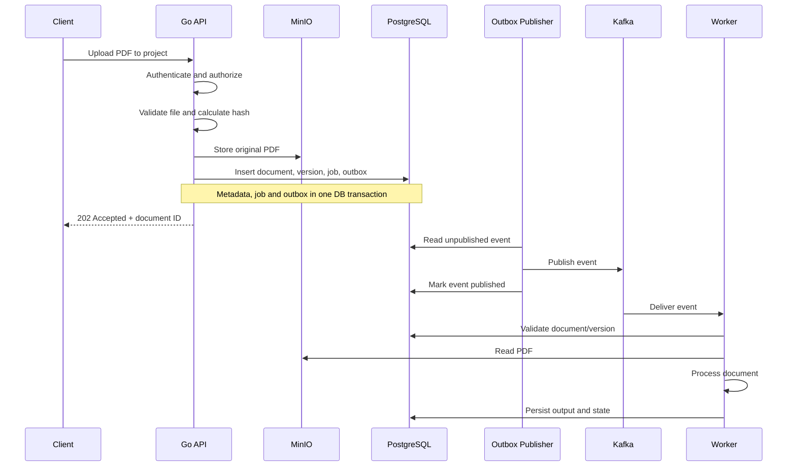
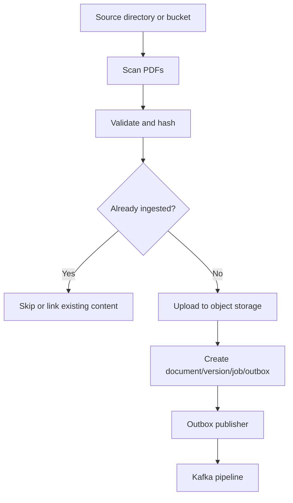
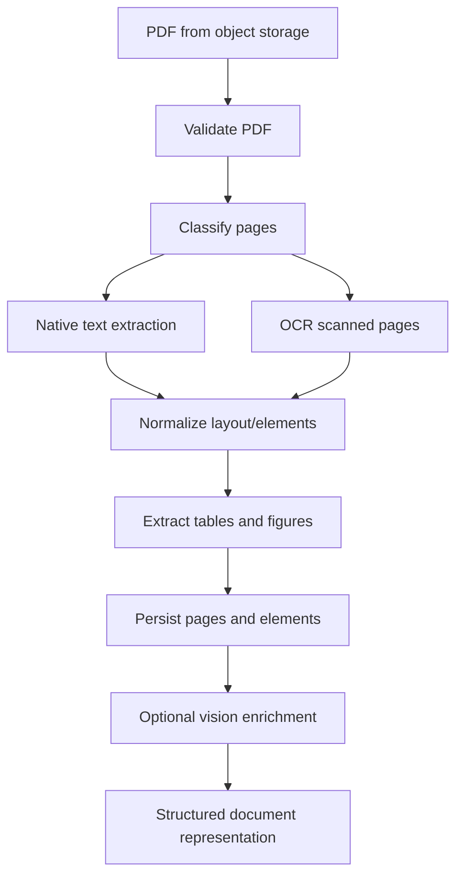
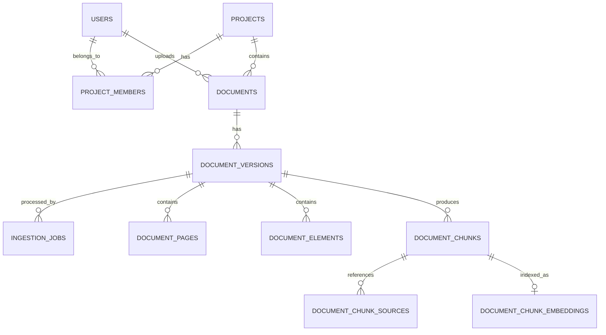
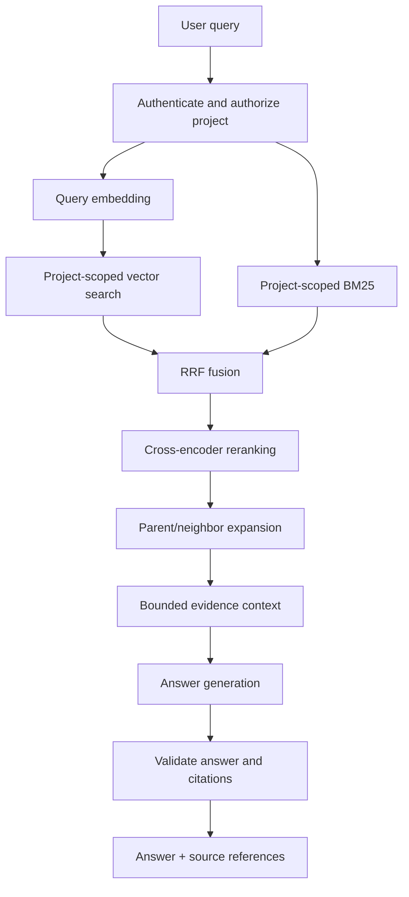
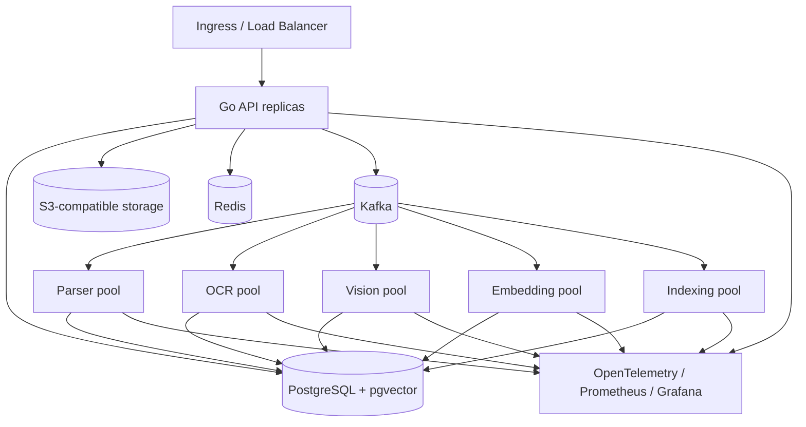

# AtlasRAG — Distributed Multimodal PDF RAG Platform

AtlasRAG is a distributed platform for bulk and continuous ingestion of PDF collections, multimodal extraction, asynchronous indexing, and project-scoped question answering.

> **Status:** This document describes the target architecture and roadmap. The current repository is a local-development prototype; authentication, project isolation, production hardening, large-scale ANN indexing, and operational controls must be completed before exposing it to untrusted users.

## Contents
1. Goals and principles
2. High-level architecture
3. Technology stack
4. Services and responsibilities
5. Ingestion workflows
6. Kafka event architecture
7. PDF and multimodal processing
8. Chunking and embeddings
9. Data model and storage
10. User and project isolation
11. Hybrid retrieval and answer generation
12. Reliability and failure handling
13. Scaling strategy
14. Capacity planning
15. Deployment
16. Observability and evaluation
17. Security
18. API design
19. Implementation roadmap
20. Prototype status and limitations

---

## 1. Goals and design principles

### Goals
- Ingest large PDF collections in bulk and through an upload API.
- Process native-text, scanned, and mixed PDFs.
- Extract text, tables, figures, and images while preserving page provenance.
- Run parsing, OCR, enrichment, chunking, embedding, and indexing asynchronously.
- Scale pipeline stages independently.
- Support semantic and lexical retrieval, fusion, reranking, and cited answers.
- Enforce user/project access boundaries throughout retrieval.
- Make failures observable, retryable, and recoverable.

### Principles
1. PostgreSQL is the system of record for application and lifecycle state.
2. Kafka transports events; it does not store PDF binaries.
3. Original PDFs and extracted binary assets live in object storage.
4. Assume at-least-once event delivery; make consumers idempotent.
5. Scale individual stages according to their bottlenecks.
6. Authorize and scope before retrieval, never after global retrieval.
7. Preserve document version, page, and source-element provenance.
8. Benchmark before adding operational complexity.

## 2. High-level architecture



Logical pipeline:

```text
Upload -> Object storage -> PostgreSQL metadata/job/outbox
       -> Outbox publisher -> Kafka
       -> Parse/OCR -> Multimodal enrichment
       -> Chunk -> Embed -> Index -> Searchable document
```

Kafka is the asynchronous coordination layer. PostgreSQL and object storage hold durable application data.

## 3. Technology stack

| Area | Proposed technology | Responsibility |
|---|---|---|
| API | Go, Gin | Upload, project APIs, status, search, PDF access |
| Workers | Python | Parsing, OCR orchestration, enrichment, chunking |
| Events | Apache Kafka | Decoupled pipeline stages |
| Metadata/state | PostgreSQL | Users, projects, documents, versions, jobs, outbox |
| Vector retrieval | pgvector | Dense embeddings and similarity search |
| Object storage | MinIO / S3 | PDFs, extracted images, page assets |
| Cache | Redis | Caching and short-lived coordination |
| PDF parsing | PyMuPDF, pypdf, Docling or Unstructured | Text/layout extraction |
| OCR | Tesseract or PaddleOCR | Scanned-page extraction |
| Vision | GPT-4o or another vision-capable model | Figure, chart, and complex-table descriptions |
| Embeddings | `text-embedding-3-small` or equivalent | Dense text vectors |
| Reranking | BGE reranker or equivalent | Cross-encoder relevance refinement |
| Observability | OpenTelemetry, Prometheus, Grafana | Traces, metrics, dashboards |
| Evaluation | LangSmith or equivalent | LLM traces and quality evaluation |
| Local deployment | Docker Compose | Development |
| Production | Kubernetes + KEDA | Orchestration and event-driven scaling |

These are proposed components, not immutable dependencies.

## 4. Services and responsibilities

### Go API gateway
- Authenticate users and establish trusted identity.
- Create projects and manage membership.
- Authorize access to projects and documents.
- Validate uploads and store source PDFs.
- Register document metadata, versions, jobs, and outbox events.
- Expose status, source access, search, and answer endpoints.
- Return citations and source metadata.

The API should not synchronously parse and embed an entire PDF during upload. Persist the upload, enqueue work, and return `202 Accepted`.

### Python workers
- Read PDFs from object storage.
- Validate integrity and supported formats.
- Extract native text and layout.
- Detect scanned pages and invoke OCR selectively.
- Extract tables and images.
- Generate optional vision descriptions.
- Produce structured page/element records and chunks.
- Generate embeddings in batches and persist indexing results.

Deploy processing stages independently so each can scale according to its own resource profile.

### PostgreSQL
Stores users, projects, memberships, document metadata/versions, job state, outbox events, extracted page and element metadata, chunks, provenance, and vectors.

### MinIO / S3
Stores original PDFs, extracted images/figures, rendered page images, and other binary artifacts.

Example object keys:

```text
projects/{project_id}/documents/{document_id}/v{version}/source.pdf
projects/{project_id}/documents/{document_id}/v{version}/pages/{page_number}.png
projects/{project_id}/documents/{document_id}/v{version}/assets/{asset_id}.png
```

Object-key structure is organizational, not an authorization boundary.

## 5. Ingestion workflows

### 5.1 Continuous API ingestion



Suggested endpoint:

```http
POST /api/v1/projects/{project_id}/documents
Content-Type: multipart/form-data
Authorization: Bearer <token>
```

API steps:
1. Verify JWT and derive user identity from its trusted `sub` claim.
2. Check project membership and upload permission.
3. Validate file type, signature, and size.
4. Calculate SHA-256 for deduplication.
5. Upload the PDF to object storage.
6. Insert document and version records.
7. Insert the initial ingestion job.
8. Insert an outbox event in the same DB transaction.
9. Return the document ID and status URL.

### 5.2 Bulk ingestion



The bulk importer should enumerate PDFs, validate them, calculate hashes, deduplicate according to policy, upload originals, and register jobs/events with bounded concurrency. It must resume safely after interruption.

Bulk and API ingestion should converge on the same processing pipeline.

### 5.3 Transactional outbox

A PostgreSQL transaction cannot atomically commit both a row and a Kafka message without distributed transaction coordination. Use the outbox pattern:

```text
BEGIN
  INSERT document
  INSERT document_version
  INSERT ingestion_job
  INSERT outbox_event
COMMIT
```

A publisher reads unpublished outbox rows, publishes them to Kafka, and marks them published. If it crashes after Kafka accepts the event but before `published_at` is updated, it may publish the event again. This is expected: delivery is **at least once**, not exactly once. Consumers must be idempotent.

## 6. Kafka event architecture

Suggested topics:

| Topic | Purpose |
|---|---|
| `document.uploaded` | Source document registered |
| `document.parse.requested` | Parsing should begin |
| `document.parsed` | Page/element extraction completed |
| `document.enrichment.requested` | Vision/table enrichment requested |
| `document.enriched` | Enrichment completed |
| `document.chunked` | Chunks and provenance created |
| `embedding.requested` | Embeddings should be generated |
| `embedding.completed` | Embedding generation completed |
| `document.indexed` | Document version is searchable |
| `document.failed` | Terminal processing failure |
| `document.dlq` | Event requires inspection after retry policy |

A first implementation can use fewer topics and split them as needed.

### Event payload

Publish references and metadata, not PDF bytes:

```json
{
  "event_id": "b9c2c0a4-7f6c-4d8e-8c55-9d3b2c7f2f31",
  "event_type": "document.parse.requested",
  "document_id": "2d9d2e4b-4d3f-4f89-aed4-1d1d9b6c9e10",
  "project_id": "6c4c8b5c-6ed9-4f1a-9f47-9a3d0a8f0f21",
  "version": 1,
  "object_key": "projects/.../source.pdf",
  "requested_at": "2026-11-07T10:00:00Z",
  "trace_id": "optional-trace-id"
}
```

The event is a notification, not the source of truth. Workers load the authoritative document/version from PostgreSQL and verify that the event remains valid.

### Partitioning and consumers
- Key messages by `document_id` to preserve per-document ordering within a topic partition.
- Kafka does not provide global ordering across topics.
- Validate version and lifecycle state in consumers.
- Start with a modest partition count and benchmark.
- Do not create one topic per project.
- Commit offsets only after durable processing state has been recorded.
- Use bounded retries with backoff and a DLQ for poison messages.

## 7. PDF and multimodal processing

PDFs may contain native text, scanned pages, vector graphics, tables, and mixed content. Classify the PDF or individual pages:

- Native-text pages: extract text directly.
- Scanned pages: use OCR.
- Mixed pages: combine native extraction and OCR for image regions.
- Complex layouts: use layout-aware parsing for columns, tables, and reading order.



Potential tools:
- PyMuPDF or pypdf for PDF access and native extraction.
- Docling or Unstructured for layout-aware extraction.
- Tesseract or PaddleOCR for OCR.
- Poppler utilities for rendering pages.

### Preserve provenance

For each element, preserve document ID/version, page number, element index/type, text or structured content, bounding box if available, extraction method/parser version, and asset object key.

### Tables, figures, and images

- Store structured table content where possible, alongside a text representation for retrieval.
- Extract images or render relevant page regions.
- Store assets in MinIO/S3.
- Optionally generate concise descriptions with a vision-capable model.
- Link descriptions to the original asset and page.
- Include descriptions in searchable text when useful.

Embedding a vision-generated caption as text is **text-based image enrichment**, not true visual-vector retrieval. Visual retrieval requires a vision embedding model and separate evaluation.

Enforce limits on file size, page count, image size, CPU, memory, and processing time. Handle encrypted, malformed, and unsupported PDFs explicitly.

## 8. Chunking and embeddings

Use structure-aware chunking rather than arbitrary whole-document character splitting.

Starting values to benchmark:

| Parameter | Initial value |
|---|---:|
| Child chunk size | ~500 tokens |
| Child overlap | ~50 tokens |
| Parent chunk size | ~1,500–2,000 tokens |
| Initial retrieval candidates | 50–100 |
| Final reranked context | 5–10 chunks |

Chunking should respect section/page boundaries, preserve headings and parent-child relationships, keep tables coherent, attach page/element provenance, avoid empty chunks, and store token counts and chunk types.

A deterministic chunk identity can be based on:

```text
document_id + document_version + chunk_index
```

Version parser/chunking configuration when reprocessing so incompatible outputs are not silently mixed.

### Embedding generation
- Batch requests for throughput.
- Apply rate limits and bounded concurrency.
- Retry transient provider errors with backoff and jitter.
- Record model name and dimensions.
- Do not mix vectors from different models in one search operation unless explicitly designed for it.
- Make re-embedding resumable and version-aware.

## 9. Data model and storage

### Logical relationships



### Suggested tables

**`users`**
- `id`, `email`, `display_name`, `created_at`, `updated_at`

**`projects`**
- `id`, `name`, `description`, `created_by`, `created_at`, `updated_at`

**`project_members`**
- `project_id`, `user_id`, `role`, `created_at`
- Unique constraint on `(project_id, user_id)`.

**`documents`**
- `id`, `project_id`, `uploaded_by`, `filename`, `object_key`, `content_hash`, `mime_type`, `file_size`, `current_version`, `page_count`, `status`, timestamps.
- A document belongs to a project. `uploaded_by` is audit metadata, not the access boundary.

**`document_versions`**
- `document_id`, `version`, `object_key`, `content_hash`, `parser_version`, `embedding_model`, `status`, `created_at`.
- Unique key on `(document_id, version)`.

**`ingestion_jobs`**
- `id`, `document_id`, `version`, `stage`, `status`, `attempt_count`, `last_error`, `started_at`, `completed_at`, `updated_at`.
- Add an idempotency constraint for document/version/stage.

**`outbox_events`**
- `id`, `aggregate_id`, `event_type`, `payload`, `created_at`, `published_at`, `attempt_count`.

**`document_pages`**
- `document_id`, `version`, `page_number`, `extracted_text`, `extraction_method`, `metadata`.

**`document_elements`**
- `document_id`, `version`, `element_index`, `page_number`, `category`, `content`, `metadata`, `asset_object_key`.

**`document_chunks`**
- `document_id`, `version`, `chunk_index`, `parent_chunk_id`, `content`, `token_count`, `page_start`, `page_end`, `chunk_type`, `metadata`.

**`document_chunk_sources`**
- Maps each chunk to its source page and/or extracted elements using document/version/chunk/source identifiers.

**`document_chunk_embeddings`**
- `document_id`, `version`, `chunk_index`, `embedding`, `embedding_model`, `searchable_text`, `created_at`.
- Vector dimension must match the chosen embedding model. Use a foreign key to the chunk.

### Initial indexes

```sql
CREATE INDEX idx_documents_project
    ON documents(project_id);

CREATE INDEX idx_documents_status
    ON documents(status);

CREATE INDEX idx_chunks_document_version
    ON document_chunks(document_id, version);

CREATE INDEX idx_jobs_status_updated
    ON ingestion_jobs(status, updated_at);

CREATE INDEX idx_outbox_unpublished
    ON outbox_events(created_at)
    WHERE published_at IS NULL;
```

Optional pgvector HNSW index for cosine distance:

```sql
CREATE INDEX idx_chunk_embeddings_hnsw
ON document_chunk_embeddings
USING hnsw (embedding vector_cosine_ops);
```

Benchmark index configuration against recall, latency, memory, and filtered-query behavior. Store metadata/chunks/vectors in PostgreSQL; keep large PDF and image binaries in object storage.

## 10. User and project isolation

Project membership is the primary access boundary:

```text
User -- membership + role --> Project --> Documents
```

Suggested roles:

| Role | Permissions |
|---|---|
| OWNER | Full project control, membership and deletion |
| ADMIN | Manage documents and members |
| MEMBER | Upload and search |
| VIEWER | Read/search permitted content |

Create a project and its creator membership in one transaction:

```sql
BEGIN;

INSERT INTO projects (id, name, created_by)
VALUES ($1, $2, $3);

INSERT INTO project_members (project_id, user_id, role)
VALUES ($1, $3, 'OWNER');

COMMIT;
```

### Authentication and authorization
- Verify JWT signatures and claims.
- Derive user ID from verified token `sub`.
- Never trust a user ID in the request body as caller identity.
- Check membership and role before document operations.
- Derive project scope from the authorized route/context.
- Apply checks to status, chunks, PDF download, search, answer, and deletion.

### Project-scoped pgvector query

A shared pgvector table is sufficient initially. There is no need for one database, table, or Kafka topic per project.

If `project_id` is stored on `documents`, join through that table:

```sql
SELECT
    c.document_id,
    c.version,
    c.chunk_index,
    c.content,
    e.embedding <=> $1 AS distance
FROM document_chunk_embeddings AS e
JOIN document_chunks AS c
  ON c.document_id = e.document_id
 AND c.version = e.version
 AND c.chunk_index = e.chunk_index
JOIN documents AS d
  ON d.id = c.document_id
WHERE d.project_id = $2
  AND d.status = 'COMPLETED'
  AND d.current_version = c.version
ORDER BY e.embedding <=> $1
LIMIT $3;
```

- `$1`: query embedding.
- `$2`: project ID from authenticated, authorized request context.
- `$3`: requested candidate count.

`d.project_id = $2` scopes candidates to the project. Apply the same scope to lexical retrieval, RRF, reranking, and LLM context. Never retrieve globally and filter afterward.

### Filtering and ANN performance
The project predicate is the correctness boundary. A global HNSW index is not physically partitioned by project, and selective filters can affect the number of candidates returned. Benchmark filtered ANN recall and latency. Consider denormalizing `project_id` into embedding rows or partitioning only if measurements justify it. Avoid one partition per project when there may be many small projects.

Also scope BM25 statistics, caches, source downloads, deletion, and reprocessing. Cache keys must include project/authorization scope.

## 11. Hybrid retrieval and answer generation

Dense and lexical retrieval complement one another:
- Dense vectors handle semantic similarity and paraphrases.
- BM25 handles exact terms, names, identifiers, and domain vocabulary.

Run both paths in parallel and apply the same project filter.



### Reciprocal Rank Fusion

A weighted RRF formulation:

\[
RRF(d) =
\frac{w_v}{k + rank_v(d)}
+
\frac{w_b}{k + rank_b(d)}
\]

Example starting values: vector weight `0.7`, BM25 weight `0.3`, and RRF constant `k = 60`. Tune against an evaluation set.

### Reranking and context
- Retrieve perhaps 50–100 candidates per retrieval path.
- Fuse candidates.
- Rerank a bounded shortlist.
- Pass approximately 5–10 high-quality chunks to the answer model.
- Deduplicate overlapping chunks, expand parent/neighbor context when needed, and enforce a token budget.

These are initial experimental values, not guaranteed optima.

### Grounded answers
The answer model should answer from supplied evidence, abstain when evidence is insufficient, and cite document/page sources. Preserve document ID, version, page range, and chunk ID in context. Treat retrieved text as untrusted data, not model instructions. Validate citation identifiers and references in code; syntactic validity alone does not prove factual support.

## 12. Reliability and failure handling

### At-least-once processing
Make every stage idempotent. Useful keys include:

```text
event_id
document_id + version + stage
document_id + version + chunk_index
```

Use unique constraints and transactional upserts.

### Retry policy

| Error | Handling |
|---|---|
| Invalid/encrypted PDF | Terminal failure; do not retry indefinitely |
| Unsupported file type | Reject or terminal failure |
| Temporary object-storage/database failure | Retry safely with backoff |
| Model rate limit | Respect retry hints and back off |
| Model timeout | Bounded retry |
| Malformed event | DLQ and alert |
| Repeated stage failure | DLQ or operator review |

Record retry count, error category, timestamps, and trace IDs.

### Version-aware processing
Before work, verify document/version existence, eligibility, completion state, and whether the document was superseded or deleted. A stale event must not overwrite a newer version.

### Backpressure and deletion
Bound worker concurrency and model-provider requests. Monitor Kafka lag. Avoid fetching more work than workers can handle. A deletion workflow must remove/invalidate metadata, chunks, vectors, extracted assets, source PDFs, search records, and caches, with durable retryable state.

## 13. Scaling strategy

| Stage | Main bottleneck | Scaling approach |
|---|---|---|
| API | Network/request concurrency | Horizontal API replicas |
| Parsing | CPU and memory | More parser workers |
| OCR | CPU/GPU and page complexity | Dedicated OCR pool |
| Vision | Model latency, quota, GPU | Separate bounded worker pool |
| Chunking | CPU | Horizontal workers |
| Embedding | Provider quota or GPU | Batching and controlled concurrency |
| Indexing | Database I/O/write throughput | Bounded indexer pool |
| Retrieval | Query latency | Query/index tuning and caching |
| Answer generation | Model latency/token throughput | Rate limits and capacity planning |

Kafka consumer parallelism is constrained by the number of partitions assigned to a consumer group. More consumers than partitions do not increase parallelism for that topic.

### Kubernetes and KEDA
When Docker Compose is stable:
- Deploy each worker stage as its own Kubernetes Deployment.
- Set CPU/memory requests and limits.
- Use KEDA to scale from Kafka lag or queue metrics.
- Keep GPU workloads on suitable node pools.
- Set maximum replica counts to protect databases and model quotas.
- Do not blindly scale indexers when PostgreSQL/vector indexing is saturated.

Scaling one stage can move the bottleneck downstream.

## 14. Capacity planning

These are illustrative planning estimates, not measured performance guarantees.

Assumptions:
- 1,000,000 PDFs.
- 10 pages per PDF on average.
- 2 chunks per page.
- 2 MB average PDF.
- 1,536-dimensional float32 vectors.

| Metric | Estimate |
|---|---:|
| Pages | 10 million |
| Chunks | 20 million |
| Original PDF storage | 2 TB |
| Raw vector storage | 122.88 GB |
| Raw vector storage with two copies | 245.76 GB |

Raw vector calculation:

\[
20{,}000{,}000 \times 1536 \times 4
= 122{,}880{,}000{,}000 \text{ bytes}
\]

This excludes ANN index overhead, metadata, PostgreSQL overhead, WAL, backups, replicas, and headroom.

### Ingestion rate examples

| Target window | Average PDFs/second |
|---|---:|
| 30 days | ~0.39 |
| 7 days | ~1.65 |
| 24 hours | ~11.57 |

If parsing averages 8 seconds/PDF at 12 PDFs/second, Little's Law gives:

\[
L = \lambda W = 12 \times 8 = 96
\]

At 70% target utilization, a rough estimate is `96 / 0.70 ≈ 137` concurrent in-flight slots. This is not a machine count; benchmark CPU, memory, I/O, and document complexity.

For 20 million chunks over 7 days:

\[
20{,}000{,}000 / (7 \times 24 \times 3600)
\approx 33 \text{ chunks/second}
\]

With batches of 100, that is approximately 0.33 batches/second on average. Include provider quotas, retries, and bursts in real planning.

A sample query benchmark target could start at 10 sustained QPS and 50 burst QPS. These are test targets, not measured throughput.

## 15. Deployment architecture

### Local development
Use Docker Compose for:
- Go API.
- Python worker(s).
- PostgreSQL with pgvector.
- Kafka and its required metadata/quorum configuration.
- MinIO.
- Redis if needed.

Keep secrets in environment variables or a local secrets mechanism; never commit API keys.

### Production evolution



Production requirements include TLS, secret management, backups and restore testing, object-storage durability, Kafka replication/retention, resource limits, autoscaling, network policies, least-privilege service accounts, migrations/rollback, disaster recovery, and runbooks.

## 16. Observability and evaluation

Propagate trace/correlation IDs through:

```text
Upload -> Outbox -> Kafka -> Parse -> OCR/Vision -> Chunk
       -> Embed -> Index -> Retrieval -> Rerank -> LLM
```

Monitor:
- Upload rate and rejected uploads.
- Documents/pages processed per minute.
- Stage duration and error rate.
- Kafka consumer lag and rebalances.
- Retries and DLQ count.
- OCR/vision invocation rate.
- Embedding throughput and provider errors.
- PostgreSQL pool, CPU, I/O, locks, and query latency.
- Vector search latency and recall.
- Object-storage latency/errors.
- LLM latency, token usage, and cost.

Build a golden dataset with questions, expected source documents/pages, and relevant passages. Evaluate:
- Recall@K and Precision@K.
- MRR and nDCG.
- Citation accuracy.
- Answer faithfulness/groundedness.
- Abstention quality.
- End-to-end latency and cost.

Evaluate retrieval separately from answer generation.

## 17. Security

Before exposing the system to untrusted users, implement:
- Authentication and verified identity.
- Project membership and role-based authorization.
- Project-scoped retrieval at every stage.
- File signature validation and upload limits.
- Safe parsing with CPU, memory, page, and time limits.
- Malware scanning/sandboxing where appropriate.
- Signed, short-lived object URLs or API-mediated downloads.
- TLS and encryption at rest.
- Secret management and key rotation.
- Audit logs for uploads, downloads, membership changes, and deletion.
- Rate limits and per-project usage/spend limits.
- Prompt-injection defenses: retrieved document content is untrusted evidence, never system instructions.
- Tenant-aware cache keys and invalidation.
- Complete deletion across metadata, vectors, assets, and caches.

A project ID in an object key or Kafka message does not enforce security. Authorization must be checked against trusted database state.

## 18. API design

### Projects
```http
POST   /api/v1/projects
GET    /api/v1/projects
GET    /api/v1/projects/{project_id}
PATCH  /api/v1/projects/{project_id}
DELETE /api/v1/projects/{project_id}
```

### Membership
```http
GET    /api/v1/projects/{project_id}/members
POST   /api/v1/projects/{project_id}/members
PATCH  /api/v1/projects/{project_id}/members/{user_id}
DELETE /api/v1/projects/{project_id}/members/{user_id}
```

### Documents
```http
POST   /api/v1/projects/{project_id}/documents
GET    /api/v1/projects/{project_id}/documents
GET    /api/v1/projects/{project_id}/documents/{document_id}/status
GET    /api/v1/projects/{project_id}/documents/{document_id}/chunks
GET    /api/v1/projects/{project_id}/documents/{document_id}/pdf
DELETE /api/v1/projects/{project_id}/documents/{document_id}
```

### Search and answers
```http
POST /api/v1/projects/{project_id}/search
POST /api/v1/projects/{project_id}/answer
```

Example search request:

```json
{
  "query": "What are the key obligations in the agreement?",
  "top_k": 10
}
```

Example answer response:

```json
{
  "answer": "The agreement requires ...",
  "citations": [
    {
      "document_id": "2d9d2e4b-4d3f-4f89-aed4-1d1d9b6c9e10",
      "version": 1,
      "page_start": 4,
      "page_end": 5,
      "chunk_index": 12
    }
  ]
}
```

Every document endpoint must verify that the document belongs to the route's project and that the caller has permission.

## 19. Implementation roadmap

### Phase 1 — Stabilize prototype
- Reproducible local setup and environment documentation.
- Consistent lifecycle states and structured errors.
- Tests for upload, parsing, chunking, indexing, and retrieval.
- Idempotent worker behavior.

### Phase 2 — Project and user model
- Add users, projects, and memberships.
- Add `project_id` and `uploaded_by` to documents.
- Add authentication and authorization middleware.
- Move upload/search APIs under project routes.
- Migrate existing documents into a default project.
- Enforce project scope on all endpoints.

### Phase 3 — Durable ingestion
- Complete transactional outbox publishing.
- Add event IDs, retries, idempotency, and DLQ.
- Validate version and stage state in workers.
- Build bulk importer using the same ingestion path.

### Phase 4 — Modular processing
- Separate parsing, OCR, vision, chunking, embedding, and indexing workers.
- Define stable event schemas.
- Persist stage status/timing.
- Add bounded concurrency and backpressure.

### Phase 5 — Retrieval quality
- Project-scoped vector and lexical retrieval.
- RRF and reranking.
- Parent/neighbor expansion.
- Citation validation.
- Golden evaluation dataset and baseline metrics.

### Phase 6 — Multimodal quality
- Improve scanned/mixed PDF handling.
- Preserve layout and table structure.
- Add figure/chart descriptions.
- Evaluate OCR and vision quality.
- Consider visual embeddings only if text enrichment is insufficient.

### Phase 7 — Deployment and operations
- Complete Docker Compose stack.
- Add traces, metrics, dashboards, and alerts.
- Deploy to Kubernetes.
- Add KEDA scaling based on Kafka lag.
- Configure backups, security policies, and runbooks.

### Phase 8 — Scale testing
- Benchmark representative corpora.
- Measure ingestion throughput and stage latency.
- Benchmark filtered vector and hybrid retrieval.
- Test duplicate events, failures, recovery, and reprocessing.
- Tune partitions, worker pools, indexes, and resources from measurements.

## 20. Current prototype versus target architecture

| Capability | Current prototype | Target |
|---|---|---|
| API | Go upload/status/chunks/PDF/search/answer routes | Authenticated project-scoped API |
| Ingestion | Upload + metadata/job/outbox registration | API and bulk paths sharing durable workflow |
| Eventing | Kafka `document.uploaded` flow | Versioned multi-stage event pipeline |
| Storage | MinIO for PDFs and extracted images | Durable object storage with lifecycle policies |
| Parsing | pypdf; optional Unstructured high-res path | Modular layout parsing and selective OCR |
| Multimodal | Optional GPT-4o descriptions | Dedicated enrichment stage and evaluation |
| Chunking | Page/element-aware prototype chunking | Versioned hierarchical structure-aware chunking |
| Embeddings | Optional OpenAI embeddings, 1536 dimensions | Batched/rate-limited embedding workers |
| Vector search | pgvector exact cosine search | Benchmark exact and filtered ANN/HNSW |
| Lexical search | Custom BM25 at query time | Optimized lexical index or measured PostgreSQL implementation |
| Fusion | Weighted RRF | Evaluated hybrid retrieval and reranking |
| Access | No production auth/tenant isolation | User/project membership and authorization |
| Reliability | Outbox may duplicate events; basic retries | Idempotent stages, bounded retries, DLQ, version checks |
| Deployment | Local development | Kubernetes, autoscaling, monitoring, backups |

### Known prototype limitations
- The prototype is intended for local development and is not safe to expose to untrusted clients.
- Authentication and project-level isolation are not implemented.
- An optional `tenant_id` column does not mean tenant isolation is enforced.
- The default parser path does not provide complete OCR/layout handling.
- Custom BM25 tokenizes and computes corpus statistics at query time; it is not a persistent optimized lexical index.
- Vector search currently uses exact cosine ranking, not ANN.
- Indexing is optional. A `COMPLETED` document should not be assumed to have embeddings unless indexing state is checked.
- Citation-format validation does not prove factual support.
- Enabling a later stage does not automatically reprocess previously ingested documents; a versioned reprocessing workflow is required.

---

## Architecture summary

AtlasRAG combines:
- **Go** for the API and application control plane.
- **Python** for PDF parsing and AI-heavy processing.
- **Kafka** for asynchronous, independently scalable stages.
- **PostgreSQL + pgvector** for metadata, lifecycle state, chunks, embeddings, and initial retrieval.
- **MinIO/S3** for original PDFs and extracted assets.
- **Hybrid retrieval** using vector search, BM25, RRF, and reranking.
- **Project membership** as the access boundary.
- **Kubernetes + KEDA** as the production scaling path.

Start with one shared PostgreSQL/pgvector deployment, one object store, and a small number of Kafka-backed worker stages. Add partitioning or specialized search infrastructure only when measured workload and performance requirements justify it.
